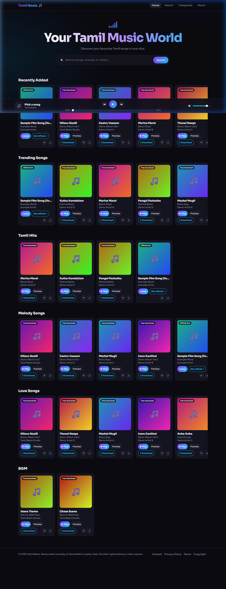

# 🎵 Tamil Beats – Song Downloader & Web Player

> A modern, sleek web application to discover, stream, and download authorized Tamil music, background scores, and latest hits.



## 🌟 Key Features
- **Instant Search:** Find songs by title, movie name, or artist with real-time filtering.
- **Curated Playlists & Categories:** Browse Melody, Love, Tamil Hits, BGM, Trending, and Latest additions.
- **Built-in Audio Player:** Full audio controls with preview mode, progress scrubbing, and volume adjustment.
- **Direct Downloads:** One-click downloads for cleared and royalty-free tracks.
- **Favorites & History:** Save favorite tracks locally and access recently played songs.
- **SEO & PWA Ready:** Optimized with JSON-LD Schema.org, Open Graph tags, sitemap, and web app manifest.

## 🚀 Live Demo & Usage
- Open `index.html` directly in any web browser, or serve locally on port `5500`:
  ```bash
  python -m http.server 5500
  ```

## 🛠️ Built With
- **Semantic HTML5** with modern SEO best practices
- **Vanilla CSS3** (Glassmorphism, dark theme, smooth micro-animations)
- **Vanilla JavaScript (ES6+)** with HTML5 Audio API & Web Storage

---
Licensed under MIT. Demo audio courtesy of SoundHelix (royalty-free).
